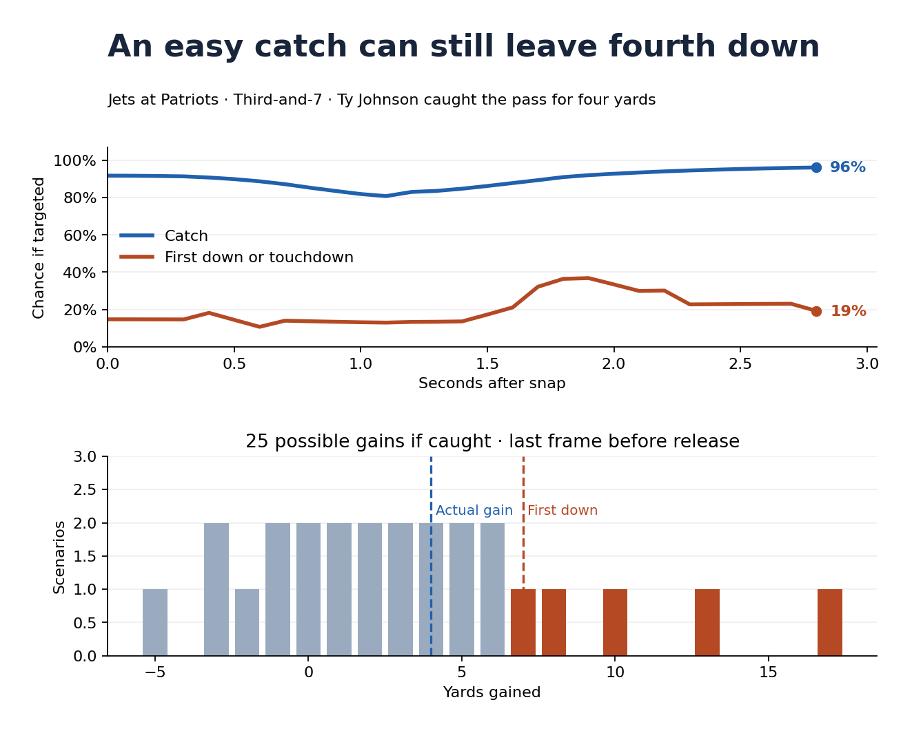

# Component A · RB receiving opportunity

**If the quarterback throws to this running back now, how valuable would that pass be?** Component A scores the passing windows on each RB route, including routes where the ball went elsewhere. The leaderboard averages the best modeled window per route. It describes receiving opportunity in the situations each back played.

[Open the offline RB dashboard](receiver_dashboard_v2.html) · [Full RB rankings](rb_rankings.csv) · [Model and validation](validation/V2.md)

Open `receiver_dashboard_v2.html` in a browser. The dashboard embeds its data and charts. It defaults to 50 scored routes and lets you compare any two of the 125 RBs.

## What the score means

For each frame, the equation is:

```text
Pass-option value = p(catch if targeted) × average ΔEP across possible completed gains
                  + p(failed catch if targeted) × ΔEP of an incompletion
```

- **Catch chance** estimates whether the pass would be completed if thrown to that back. The other probability, one minus catch chance, describes failure on that same throw.
- **Completed-pass value** averages the expected-points changes from 25 possible gains. A short gain, a first down, and a touchdown each get their own point value.
- **Incompletion value** accounts for the next down and distance. On third down, for example, the offense would face fourth down.

Expected-points change is the value of the hypothetical next state minus the value at the snap. The score takes the best three-frame average on each route, floors negative route scores at zero, then averages across scored routes. Higher means the model saw more valuable passing options per route. **This is a receiving-opportunity score.** Carries, pass protection, the QB’s choice of target, and actual EPA earned are separate.

## What to show on a replay

Ty Johnson’s outlet on third-and-seven illustrates the difference between catching a pass and moving the chains. Just before the throw, the model estimated a 96% catch chance and a 19% chance of a first down or touchdown if targeted. He gained four yards.



[Top 10 RBs with at least 50 scored routes](figures/rb_leaderboard.png)

## Evidence and limits

The 2021 Weeks 1–8 sample contains 6,913 scored RB routes. On 406 matched held-out RB throws, the first-down-or-touchdown Brier score was 0.180 versus 0.195 for a position and game-context baseline. RB ranking agreement with observed receiving yards per scored route was 0.39, and rank agreement across the two halves of the sample was 0.31. Use the leaderboard to find clips and explain specific options. Estimates for earlier frames and untargeted routes extend beyond the release-frame test, and YAC matters heavily for short passes.

## Reproduce

Run these from the workspace root. The existing v2 results are sufficient to rebuild the leaderboard and dashboard.

```bash
python3 "RB_Metric/plot_rb.py"
python3 "RB_Metric/dashboard.py"
```

To rebuild the underlying scores, follow the [v2 instructions](validation/V2.md#reproduce). Add `--example 2021102403 3868` to the scoring command, then pass the resulting `frames_2021102403_3868.csv` to `plot_rb.py --frames` to regenerate the Ty Johnson replay graphic.
